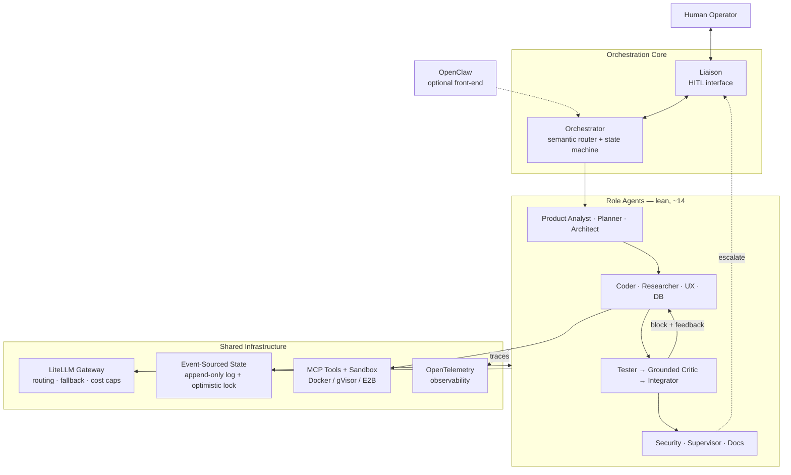
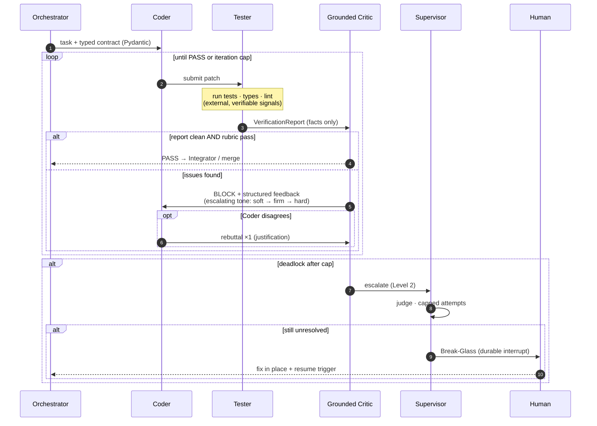

# 🤖 AI Dev-Team — A Multi-Agent SDLC Engine

> A self-hosted **multi-agent software-engineering system** (an "AI dev team") built around a **grounded feedback loop** — designed to be buildable **solo, part-time, over ~5–8 months**.

> [!NOTE]
> **Stack in one line:** Engine = **LangGraph** · Gateway = **LiteLLM** · **OpenClaw** = *optional conversational front-end*.
> **Last updated:** 2026-07-09 · **Owner:** solo build with AI coding assistants.

---

## 📑 Table of Contents

1. [Overview](#overview)
2. [System Architecture](#architecture)
3. [The Grounded Feedback Loop](#feedback-loop)
4. [Guiding Principles & North-Star](#principles)
5. [Roadmap at a Glance](#roadmap)
6. [Phase 0 — Foundation & Environment](#phase-0)
7. [Phase 1 — State, Contracts & Minimal Loop](#phase-1)
8. [Phase 2 — Grounded Verification Layer](#phase-2)
9. [Phase 3 — Gateway, Tools & Memory](#phase-3)
10. [Phase 4 — Observability & Full Roster](#phase-4)
11. [Phase 5 — Resilience & Human-in-the-Loop](#phase-5)
12. [Phase 6 — Evaluation & Adversarial Testing](#phase-6)
13. [Phase 7 — Self-Improvement & Hardening](#phase-7)
14. [Agent Roster](#roster)
15. [Non-Goals & Future Milestones](#out-of-scope)
16. [Proposed Repository Structure](#repo-structure)
17. [Definition of Done](#definition-of-done)
18. [How to Use This Roadmap](#how-to-use)
19. [Glossary](#glossary)
20. [Research Basis & Sources](#sources)
21. [License](#license)

---

## 📖 Overview

**What:** an autonomous "AI software team" that takes a well-specified coding task and returns runnable, test-passing code — with full traces, hard cost caps, sandboxed execution, and a human break-glass.

**Core idea:** verification is **tools-first** — real tests, type-checkers, linters, and execution provide the signal; the LLM only *interprets* it. This is grounded in a peer-reviewed MIT Press / TACL survey finding that LLMs **do not reliably self-correct from their own internal feedback**; reliable gains appear with **external, verifiable feedback**.

**How:** a lean team of **~14 role agents** coordinated by a **LangGraph** state machine, talking to models through a **LiteLLM** gateway, persisting to an **event-sourced state log**, and observable end-to-end via **OpenTelemetry**.

| | |
|---|---|
| **Engine** | LangGraph (stateful graph, checkpointer, native human-in-the-loop) |
| **Model Gateway** | LiteLLM (routing, fallback chains, hard cost caps) |
| **State** | Event-sourced append-only log + optimistic locking (Postgres/SQLite) |
| **Contracts** | Pydantic schemas at every agent boundary |
| **Tools** | Model Context Protocol (MCP) registry, default-deny permissions |
| **Sandbox** | Docker (hardened) → gVisor → Firecracker / E2B by threat model |
| **Memory** | mem0 / LangMem (episodic + semantic), grow only by need |
| **Observability** | OpenTelemetry GenAI semantic conventions → Langfuse / Phoenix |
| **Evaluation** | DeepEval / promptfoo · SWE-bench Verified + Lite as north-star |
| **Self-Improvement** | DSPy / GEPA offline prompt optimization |
| **Front-end** | OpenClaw (optional channel layer) |

[↑ Back to top](#top)

---

## 🏛️ System Architecture

> [!IMPORTANT]
> The **Event-Sourced State log** is the backbone: every mutation is an immutable event, so any run is replayable and any crash is recoverable. The **feedback edge** (`Verify → block + feedback → Build`) is the heart of the system — detailed below.

[↑ Back to top](#top)

---

## 🔁 The Grounded Feedback Loop

The core cycle. The **first critic is a set of tools**, not an LLM — the LLM critic only interprets verifiable results.

[↑ Back to top](#top)

---

## 🧭 Guiding Principles & North-Star

> [!IMPORTANT]
> 1. **Start simple, add complexity only when measured** *(Anthropic — Building Effective Agents)*. Every agent and layer must earn its place.
> 2. **Multi-agent costs more tokens & latency than single-agent** *(Anthropic; ChatDev)* — so extra agents must pay for themselves in quality.
> 3. **Verification is tools-first** *(MIT Press / TACL self-correction survey)* — external signals lead; the LLM only interprets.
> 4. **North-Star benchmark:** **SWE-bench Verified (500) + Lite (300) % Resolved**, tracked from day one. Also maintain 10–20 personal "golden tasks".
> 5. **The hard rule:** after every phase, re-run the harness. If a component doesn't measurably improve resolve-rate (or cost/latency at equal quality) — **cut it**.

[↑ Back to top](#top)

---

## 🗺️ Roadmap at a Glance

| Phase | Focus | Est. Effort | Status |
|:---:|---|:---:|:---:|
| **0** | Foundation + local environment | ~1 week | ✅ Done |
| **1** | State + contracts + minimal loop | ~4–6 wks | ✅ Done |
| **2** | Grounded verification layer | ~3–4 wks | ✅ Done |
| **3** | Gateway + tools + memory | ~5–6 wks | ✅ Done |
| **4** | Observability + full roster | ~5–6 wks | ✅ Done |
| **5** | Resilience + human-in-the-loop | ~5–6 wks | 🟨 In progress |
| **6** | Evaluation + red-teaming | ~5–6 wks | ⬜ Not started |
| **7** | Self-improvement (ongoing) | ongoing | ⬜ Not started |

*Legend: ⬜ Not started · 🟨 In progress · ✅ Done. Tick the checkboxes in each phase as you build.*

[↑ Back to top](#top)

---

## 🛠️ Phase 0 — Foundation Decision & Local Dev Environment
*Week 0–1*

- [x] **Engine Choice:** build the orchestration engine on **LangGraph** — the 2026 best fit for long-running, stateful, audit-heavy workflows with built-in checkpointing and human-in-the-loop. **OpenClaw** is kept as an optional conversational front-end.
- [x] **Repository & Reproducibility:** single Python monorepo (`uv`/`poetry`), pinned dependencies, `Makefile` targets, and a `docker-compose.yml` for local infra (Postgres + vector store + LiteLLM + an OTLP backend). Everything runs on one workstation; no cloud required for v1.
- [x] **Golden Task Set (Day-One Eval Harness):** wire up **SWE-bench Lite** as the smoke test and pick **10–20 personal golden tasks** *before writing any agent*. Never add a component without re-running this harness to prove it helped.

[↑ Back to top](#top)

---

## 🧱 Phase 1 — Core State, Contracts & the Minimal Feedback Loop
*Week 1–6*

- [x] **Event-Sourced State Store (Append-Only Log):** workflow state as an append-only event log in Postgres (SQLite for v0). Each mutation is immutable; current state is a projection → perfect replay/debugging. Start on LangGraph's built-in checkpointer, then add the event table underneath.
- [x] **Minimal Event Schema:** every event carries `{event_id, workflow_id, agent_id, event_type, payload, version, timestamp, causation_id, correlation_id}`. `version` enables **optimistic locking** (conditional writes); `correlation_id`/`causation_id` reconstruct the execution graph and detect loops. Keep it small; add fields only on real need.
- [x] **Type-Safe Inter-Agent Contracts (Pydantic):** every boundary is a strict schema (`PRD`, `ArchitectDesign`, `CodePatch`, `ReviewReport`). Validate **before** committing to the log; on failure, return the error to the **sender** for one self-correction instead of passing malformed data downstream. *(Optionally align naming with A2A v1.0 for cheap future interop — a full A2A server is not needed for a single-framework solo system.)*
- [x] **The Minimal Viable Loop (Orchestrator + Coder + Tester + Grounded Critic):** ship the smallest end-to-end loop that produces working code — the **evaluator-optimizer** pattern. Coder generates a patch → Tester runs tests/types/lint → Grounded Critic reads those real signals + a rubric → pass or structured feedback → loop with a hard cap. **If this loop doesn't beat a single-shot baseline on your golden set, fix it before building anything else.**

[↑ Back to top](#top)

---

## 🛡️ Phase 2 — Grounded Verification Layer *(The Heart of the System)*
*Week 6–10*

- [x] **Why "Grounded" (Research Basis):** the MIT Press / TACL survey shows LLMs do **not** reliably self-correct from internally-generated feedback. Therefore verification is **tools-first**: execution results, unit tests, type checks, static analysis, and diffs are the primary signal; the LLM only interprets and prioritizes them.
- [x] **Tester Agent (External Signal Generator):** writes and runs tests in a sandbox, runs type-checker + linter, captures real stdout/stderr/exit codes. Emits a structured `VerificationReport` (failing tests, coverage delta, type errors, lint violations). **No opinions — only measured facts.**
- [x] **Grounded Critic / Reviewer (Interpreter, Cross-Model):** consumes the `VerificationReport` + diff + rubric, decides pass/block with justification. Built on a **different model family** than the Coder to reduce shared blind spots and sycophancy. Uses an **escalation ladder** of tone: soft (iter 1) → firm (iter 2) → hard block (iter 3) → escalate to Supervisor.
- [x] **Agentic Pushback (Right of Rebuttal):** the Coder may reject feedback **once per iteration** with a logical justification (*"the failing test asserts wrong behavior; here's the spec"*). If accepted, code passes; if deadlock persists, escalate. Prevents valid code being degraded by false positives and avoids infinite meta-critic layers.
- [x] **Dedicated Critics (High-Risk Roles Only):** attach dedicated critics **only** to the three highest-risk producers — **Coder, Architect, Security**. All other outputs are verified by the shared Grounded Verification Layer. Promote a role to its own dedicated critic later *only if the benchmark proves it needs one*.

[↑ Back to top](#top)

---

## 🔌 Phase 3 — Model Gateway, Tools & Memory
*Week 10–16*

- [x] **LLMOps Gateway (LiteLLM, Self-Hosted):** route every model call through a self-hosted LiteLLM proxy as one OpenAI-compatible endpoint. Off the shelf: model pinning, complexity-based routing (cheap model for simple steps, frontier for hard ones), fallback chains + cooldowns on 429/5xx, and **hard per-workflow cost caps**.
- [x] **Cost & Iteration Circuit Breakers:** global budget + iteration ceilings per workflow. On breach → halt, block further calls, alert the human. Combined with LiteLLM caps, cost becomes fully predictable.
- [x] **Decoupled Tool Registry (MCP + Default-Deny):** expose tools via **MCP** (Linux Foundation standard). Enforce a **default-deny, role-scoped** permission matrix (e.g., Coder may read files and run `git`, but is barred from destructive DB ops or prod deploys). Load only needed tool schemas (Tool-RAG) to keep context small.
- [x] **Secure Execution Sandbox (Hardened by Threat Model):** all agent-generated code runs isolated. Start with hardened **Docker** (network off, all caps dropped, read-only FS) or **gVisor** for syscall-level isolation; move to **Firecracker microVMs / E2B** for untrusted or prompt-injected code. **Never execute agent code on the host.**
- [x] **Hierarchical Memory (Start Small, Grow by Need):** add layers only when the benchmark demands:
  1. **Working memory** — the running context window.
  2. **Episodic memory** — past runs/failures in a vector store; retrieve by similarity. Use **mem0** or **LangMem** (native to LangGraph).
  3. **Semantic memory** — consolidated project facts/conventions (*"Postgres is mandated"*).
  4. **Procedural memory** *(later)* — reusable runbooks/skill snippets.
  5. **Shared graph memory** *(only if entity-heavy)* — a Neo4j/Graphiti layer; adopt