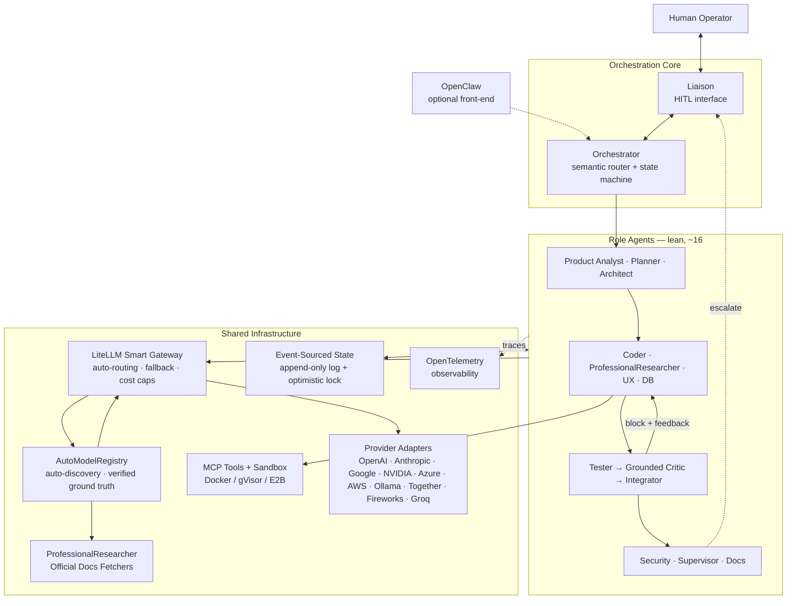
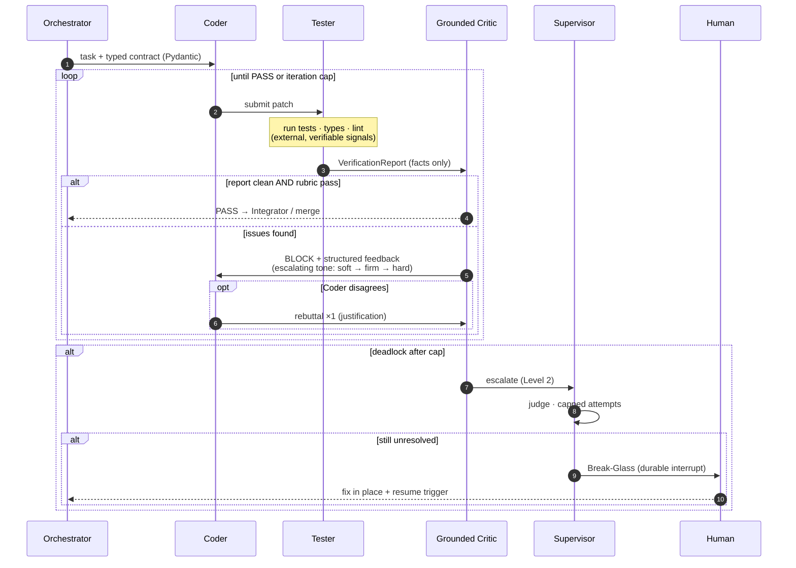

<a id="top"></a>

# 🤖 AI Dev-Team — A Multi-Agent SDLC Engine

> A self-hosted **multi-agent software-engineering system** (an "AI dev team") built around a **grounded feedback loop** — designed to be buildable **solo, part-time, over ~5–8 months**.


> [!NOTE]
> **Stack in one line:** Engine = **LangGraph** · Gateway = **LiteLLM** · **OpenClaw** = *optional conversational front-end*.
> **Last updated:** 2026-07-11 · **Owner:** solo build with AI coding assistants.

---

<a id="toc"></a>
## 📑 Table of Contents

1. [Overview](#overview)
2. [System Architecture](#architecture)
3. [The Grounded Feedback Loop](#feedback-loop)
4. [Guiding Principles & North-Star](#principles)
5. [Roadmap at a Glance](#roadmap)
6. [Phase 0 — Foundation & Environment](#phase-0)
7. [Phase 1 — State, Contracts & Minimal Loop](#phase-1)
8. [Phase 2 — Grounded Verification Layer](#phase-2)
9. [Phase 3 — Gateway, Tools & Memory](#phase-3)
10. [Phase 4 — Observability & Full Roster](#phase-4)
11. [Phase 5 — Resilience & Human-in-the-Loop](#phase-5)
12. [Phase 6 — Evaluation & Adversarial Testing](#phase-6)
13. [Phase 7 — Self-Improvement & Hardening](#phase-7)
14. [Agent Roster](#roster)
15. [Non-Goals & Future Milestones](#out-of-scope)
16. [Proposed Repository Structure](#repo-structure)
17. [Definition of Done](#definition-of-done)
18. [How to Use This Roadmap](#how-to-use)
19. [Glossary](#glossary)
20. [Research Basis & Sources](#sources)
21. [License](#license)

---

<a id="overview"></a>
## 📖 Overview

**What:** an autonomous "AI software team" that takes a well-specified coding task and returns runnable, test-passing code — with full traces, hard cost caps, sandboxed execution, and a human break-glass.

**Core idea:** verification is **tools-first** — real tests, type-checkers, linters, and execution provide the signal; the LLM only *interprets* it. This is grounded in a peer-reviewed MIT Press / TACL survey finding that LLMs **do not reliably self-correct from their own internal feedback**; reliable gains appear with **external, verifiable feedback**.

**How:** a lean team of **~14 role agents** coordinated by a **LangGraph** state machine, talking to models through a **LiteLLM** gateway, persisting to an **event-sourced state log**, and observable end-to-end via **OpenTelemetry**.

| | |
|---|---|
| **Engine** | LangGraph (stateful graph, checkpointer, native human-in-the-loop) |
| **Model Gateway** | LiteLLM Smart Gateway (auto-routing, fallback chains, hard cost caps) |
| **Model Registry** | AutoModelRegistry (auto-discovery 10+ providers, verified ground truth) |
| **State** | Event-sourced append-only log + optimistic locking (Postgres/SQLite) |
| **Contracts** | Pydantic schemas at every agent boundary |
| **Tools** | Model Context Protocol (MCP) registry, default-deny permissions |
| **Sandbox** | Docker (hardened) → gVisor → Firecracker / E2B by threat model |
| **Memory** | mem0 / LangMem (episodic + semantic), grow only by need |
| **Observability** | OpenTelemetry GenAI semantic conventions → Langfuse / Phoenix |
| **Evaluation** | DeepEval / promptfoo · SWE-bench Verified + Lite as north-star |
| **Self-Improvement** | DSPy / GEPA offline prompt optimization |
| **Research** | ProfessionalResearcherAgent (verified sources only + citations) |
| **Human Interface** | LiaisonAgent (natural language → system action) |
| **Front-end** | OpenClaw (optional channel layer) |

[↑ Back to top](#top)

---

<a id="architecture"></a>
## 🏛️ System Architecture



> [!IMPORTANT]
> The **Event-Sourced State log** is the backbone: every mutation is an immutable event, so any run is replayable and any crash is recoverable. The **feedback edge** (`Verify → block + feedback → Build`) is the heart of the system — detailed below.

[↑ Back to top](#top)

---

<a id="feedback-loop"></a>
## 🔁 The Grounded Feedback Loop

The core cycle. The **first critic is a set of tools**, not an LLM — the LLM critic only interprets verifiable results.



[↑ Back to top](#top)

---

<a id="principles"></a>
## 🧭 Guiding Principles & North-Star

> [!IMPORTANT]
> 1. **Start simple, add complexity only when measured** *(Anthropic — Building Effective Agents)*. Every agent and layer must earn its place.
> 2. **Multi-agent costs more tokens & latency than single-agent** *(Anthropic; ChatDev)* — so extra agents must pay for themselves in quality.
> 3. **Verification is tools-first** *(MIT Press / TACL self-correction survey)* — external signals lead; the LLM only interprets.
> 4. **North-Star benchmark:** **SWE-bench Verified (500) + Lite (300) % Resolved**, tracked from day one. Also maintain 10–20 personal "golden tasks".
> 5. **The hard rule:** after every phase, re-run the harness. If a component doesn't measurably improve resolve-rate (or cost/latency at equal quality) — **cut it**.
> 6. **Verified Ground Truth for Data Layer | Full LLM Reasoning for Reasoning Layer** — Data Layer (ModelRegistry, SmartGateway, ProviderAdapters, CostTracker, ConfigManager) **never guesses**; every field has a verified source + citation. Reasoning Layer (Coder, Architect, Critic, Planner, Researcher, Tester, Liaison) **never stops reasoning**; full LLM reasoning for all decisions.
> 7. **Auto-Discovery Default + Manual Override Via Liaison Chat** — System starts in **Auto Mode**: discovers, validates, registers models from official sources. User says: *"أضف gpt-4o-mini من Azure eastus2 واجعله افتراضي للمهام البسيطة"* → System executes end-to-end. No code changes, no config file edits, no restarts.
> 8. **Zero Real API Calls in Tests** — All tests use `MockGateway`, `MockProviderAPIs`, `MockEventStore`. CI/CD runs completely offline.
> 9. **Circuit Breakers Everywhere** — Per-model, per-provider, per-workflow budget caps. Automatic fallback chains with cooldown. Health monitoring with alerting.

[↑ Back to top](#top)

---

<a id="roadmap"></a>
## 🗺️ Roadmap at a Glance

| Phase | Focus | Est. Effort | Status |
|:---:|---|:---:|:---:|
| **0** | Foundation + local environment + **Critical Fixes** | ~1 week | ✅ Done |
| **1** | State + contracts + minimal loop + **Auto-Discovery Registry Core** | ~4–6 wks | ✅ Done |
| **2** | Grounded verification layer + **Professional Researcher Agent** | ~3–4 wks | ✅ Done |
| **3** | Gateway + tools + memory + **Smart Gateway + Provider Adapters** | ~5–6 wks | ✅ Done |
| **4** | Observability + full roster + **Professional Researcher Integration** | ~5–6 wks | ✅ Done |
| **5** | Resilience + human-in-the-loop + **Liaison Chat Interface** | ~5–6 wks | ✅ Done |
| **6** | Evaluation + red-teaming | ~5–6 wks | ✅ Done |
| **7** | Self-improvement (ongoing) | ongoing | ⬜ Not started |

*Legend: ⬜ Not started · 🟨 In progress · ✅ Done. Tick the checkboxes in each phase as you build.*

[↑ Back to top](#top)

---

<a id="phase-0"></a>
## 🛠️ Phase 0 — Foundation Decision & Local Dev Environment
*Week 0–1*

- [x] **Engine Choice:** build the orchestration engine on **LangGraph** — the 2026 best fit for long-running, stateful, audit-heavy workflows with built-in checkpointing and human-in-the-loop. **OpenClaw** is kept as an optional conversational front-end.
- [x] **Repository & Reproducibility:** single Python monorepo (`uv`/`poetry`), pinned dependencies, `Makefile` targets, and a `docker-compose.yml` for local infra (Postgres + vector store + LiteLLM + an OTLP backend). Everything runs on one workstation; no cloud required for v1.
- [x] **Golden Task Set (Day-One Eval Harness):** wire up **SWE-bench Lite** as the smoke test and pick **10–20 personal golden tasks** *before writing any agent*. Never add a component without re-running this harness to prove it helped.
- [x] **Fix Circular Imports (3 files):** `src/orchestrator/runner.py` (lazy import `GraphState, build_feedback_loop`), `src/agents/supervisor.py` (lazy import `run_workflow`), `src/agents/__init__.py` (lazy import `SupervisorAgent` via `__getattr__`).
- [x] **Unify Model Mapping (3 sources):** `config/litellm.yaml` (add OpenAI, Anthropic, Google, Azure entries), `src/gateway/llm_client.py` (match litellm.yaml + support all providers), `tests/test_phase3_gateway.py` (update assertions for unified model map).
- [x] **Build Mock Test Infrastructure (New Files):** `tests/conftest.py`, `tests/mocks/mock_gateway.py`, `tests/mocks/mock_models.py`, `tests/mocks/mock_provider_apis.py`, `tests/mocks/mock_event_store.py`, `tests/mocks/mock_researcher.py`, `tests/fixtures/sample_models.json`, `tests/fixtures/sample_pricing.json`, `tests/fixtures/golden_tasks.yaml`. All 411 tests pass with **zero real API calls**.

[↑ Back to top](#top)

---

<a id="phase-1"></a>
## 🧱 Phase 1 — Core State, Contracts & the Minimal Feedback Loop
*Week 1–6*

- [x] **Event-Sourced State Store (Append-Only Log):** workflow state as an append-only event log in Postgres (SQLite for v0). Each mutation is immutable; current state is a projection → perfect replay/debugging. Start on LangGraph's built-in checkpointer, then add the event table underneath.
- [x] **Minimal Event Schema:** every event carries `{event_id, workflow_id, agent_id, event_type, payload, version, timestamp, causation_id, correlation_id}`. `version` enables **optimistic locking** (conditional writes); `correlation_id`/`causation_id` reconstruct the execution graph and detect loops. Keep it small; add fields only on real need.
- [x] **Type-Safe Inter-Agent Contracts (Pydantic):** every boundary is a strict schema (`PRD`, `ArchitectDesign`, `CodePatch`, `ReviewReport`). Validate **before** committing to the log; on failure, return the error to the **sender** for one self-correction instead of passing malformed data downstream. *(Optionally align naming with A2A v1.0 for cheap future interop — a full A2A server is not needed for a single-framework solo system.)*
- [x] **The Minimal Viable Loop (Orchestrator + Coder + Tester + Grounded Critic):** ship the smallest end-to-end loop that produces working code — the **evaluator-optimizer** pattern. Coder generates a patch → Tester runs tests/types/lint → Grounded Critic reads those real signals + a rubric → pass or structured feedback → loop with a hard cap. **If this loop doesn't beat a single-shot baseline on your golden set, fix it before building anything else.**
- [x] **Auto-Discovery Model Registry Core:** `src/gateway/model_registry.py` — `AutoModelRegistry` with `ModelSpec`, `SourceCitation`, `ModelCapabilities`, `ModelPricing`, `ModelLimits`, `ModelStatus` enums. Provider Adapters for 10+ providers (OpenAI, Anthropic, Google, NVIDIA NIM, Azure, AWS Bedrock, Ollama, Together, Fireworks, Groq). Auto-discovery with scheduled refresh, manual override via Liaison, cross-validation with Professional Researcher.

[↑ Back to top](#top)

---

<a id="phase-2"></a>
## 🛡️ Phase 2 — Grounded Verification Layer *(The Heart of the System)*
*Week 6–10*

- [x] **Why "Grounded" (Research Basis):** the MIT Press / TACL survey shows LLMs do **not** reliably self-correct from internally-generated feedback. Therefore verification is **tools-first**: execution results, unit tests, type checks, static analysis, and diffs are the primary signal; the LLM only interprets and prioritizes them.
- [x] **Tester Agent (External Signal Generator):** writes and runs tests in a sandbox, runs type-checker + linter, captures real stdout/stderr/exit codes. Emits a structured `VerificationReport` (failing tests, coverage delta, type errors, lint violations). **No opinions — only measured facts.**
- [x] **Grounded Critic / Reviewer (Interpreter, Cross-Model):** consumes the `VerificationReport` + diff + rubric, decides pass/block with justification. Built on a **different model family** than the Coder to reduce shared blind spots and sycophancy. Uses an **escalation ladder** of tone: soft (iter 1) → firm (iter 2) → hard block (iter 3) → escalate to Supervisor.
- [x] **Agentic Pushback (Right of Rebuttal):** the Coder may reject feedback **once per iteration** with a logical justification (*"the failing test asserts wrong behavior; here's the spec"*). If accepted, code passes; if deadlock persists, escalate. Prevents valid code being degraded by false positives and avoids infinite meta-critic layers.
- [x] **Dedicated Critics (High-Risk Roles Only):** attach dedicated critics **only** to the three highest-risk producers — **Coder, Architect, Security**. All other outputs are verified by the shared Grounded Verification Layer. Promote a role to its own dedicated critic later *only if the benchmark proves it needs one*.
- [x] **Professional Researcher Agent (Verified Ground Truth):** `src/agents/professional_researcher.py` — **ProfessionalResearcherAgent** with zero LLM knowledge, zero guessing. Every piece of data = official source + timestamp + confidence. Provider-specific Doc Fetchers: OpenAI (platform.openai.com), Anthropic (docs.anthropic.com), Google (Vertex AI), NVIDIA (build.nvidia.com), Azure (learn.microsoft.com), AWS (aws.amazon.com/bedrock), Ollama (ollama.com/library). Research Tasks: `research_model_spec`, `research_provider_pricing`, `research_provider_capabilities`, `cross_validate`, `fetch_official_docs`. Source Citation Structure: `source_type` (api/official_docs/pricing_page/model_card/changelog), `url`, `provider`, `accessed_at`, `field_mapping`, `confidence` (API=1.0, pricing_page=0.9, docs=0.85), `raw_snippet`. LLM Tools for Reasoning Layer: `fetch_official_page`, `call_provider_api`, `parse_pricing_table`, `validate_model_card`.

[↑ Back to top](#top)

---

<a id="phase-3"></a>
## 🔌 Phase 3 — Model Gateway, Tools & Memory
*Week 10–16*

- [x] **LLMOps Gateway (LiteLLM, Self-Hosted):** route every model call through a self-hosted LiteLLM proxy as one OpenAI-compatible endpoint. Off the shelf: model pinning, complexity-based routing (cheap model for simple steps, frontier for hard ones), fallback chains + cooldowns on 429/5xx, and **hard per-workflow cost caps**.
- [x] **Cost & Iteration Circuit Breakers:** global budget + iteration ceilings per workflow. On breach → halt, block further calls, alert the human. Combined with LiteLLM caps, cost becomes fully predictable.
- [x] **Decoupled Tool Registry (MCP + Default-Deny):** expose tools via **MCP** (Linux Foundation standard). Enforce a **default-deny, role-scoped** permission matrix (e.g., Coder may read files and run `git`, but is barred from destructive DB ops or prod deploys). Load only needed tool schemas (Tool-RAG) to keep context small.
- [x] **Secure Execution Sandbox (Hardened by Threat Model):** all agent-generated code runs isolated. Start with hardened **Docker** (network off, all caps dropped, read-only FS) or **gVisor** for syscall-level isolation; move to **Firecracker microVMs / E2B** for untrusted or prompt-injected code. **Never execute agent code on the host.**
- [x] **Hierarchical Memory (Start Small, Grow by Need):** add layers only when the benchmark demands:
  1. **Working memory** — the running context window.
  2. **Episodic memory** — past runs/failures in a vector store; retrieve by similarity. Use **mem0** or **LangMem** (native to LangGraph).
  3. **Semantic memory** — consolidated project facts/conventions (*"Postgres is mandated"*).
  4. **Procedural memory** *(later)* — reusable runbooks/skill snippets.
  5. **Shared graph memory** *(only if entity-heavy)* — a Neo4j/Graphiti layer; adopt only when simpler stores prove insufficient.
- [x] **Smart Gateway + Auto Router + Resilience Layer:** `src/gateway/smart_gateway.py` — **SmartGateway** (THE ONLY GATEWAY, no direct litellm calls). `src/gateway/smart_router.py` — **SmartRouter** with decision factors: Task Complexity, Required Capabilities, Cost Budget, Performance History, Availability, USER PREFERENCE (Manual Override via Liaison). `src/gateway/resilience.py` — Per-model Circuit Breakers, Fallback Chains with cooldown, Rate limit tracking per provider/model, Health monitoring with alerting. `src/gateway/llm_client.py` — Updated to use SmartGateway, removed direct litellm calls, unified DEFAULT_MODEL_MAP with litellm.yaml.

[↑ Back to top](#top)

---

<a id="phase-4"></a>
## 📊 Phase 4 — Observability & the Full Agent Roster
*Week 16–22*

- [x] **Observability (OpenTelemetry GenAI Conventions):** instrument with the OTel **GenAI semantic conventions** from the start (a 2026 standard emitted by LangChain/CrewAI/AutoGen). Emit `invoke_agent → chat → execute_tool` spans with `gen_ai.*` attributes (model, in/out tokens, finish reason) and metrics (`gen_ai.client.token.usage`, `gen_ai.client.operation.duration`). Prompt-content capture **off by default** (privacy). View traces in **Langfuse/Phoenix** or any OTLP backend. Exposes silent failures, loops, and cost hotspots.
- [x] **Dynamic Routing Orchestrator (Decoupled):**
  1. a fast **Semantic Router** on a small model classifies task complexity with **confidence-aware routing** — below threshold it falls back to the safe full pipeline;
  2. a deterministic **State Machine** (LangGraph) executes. Simple tasks take a **Fast Lane** (Coder + Grounded Critic); complex tasks take the full SDLC path.
- [x] **Concurrency (DAG Fan-out / Fan-in):** independent agents (Architect, UX, Security research) run in parallel; outputs converge (Fan-in) at the Integrator. Concurrent writes to the state log are made safe by optimistic locking. LangGraph does this natively.
- [x] **Milestone-Based Documentation:** the Docs agent runs **twice**, not every step — post-architecture (ADRs) and post-integration (READMEs, OpenAPI/Swagger, inline docs) from the final verified output only.

> [!NOTE]
> **DevOps/SRE** and **Multi-tenancy** roles are addressed in [Non-Goals & Future Milestones](#out-of-scope).

[↑ Back to top](#top)

---

<a id="phase-5"></a>
## 🧑‍💻 Phase 5 — Resilience, Human-in-the-Loop & Pre-Execution Safety
*Week 22–28*

- [x] **Resilience & Self-Healing:**
  1. **Retry with exponential backoff + jitter** for transient/429 errors (avoids retry storms).
  2. **Bulkhead isolation** — each agent in its own async task / sandbox so one crash can't freeze the pipeline.
  3. **Graceful degradation** — classify agents as hard-blocking (Coder, Tester, Grounded Critic) vs soft-optional (UX, Docs); bypass a failed soft-optional agent with a default + warning instead of halting.
  4. **State re-hydration** — on crash, respawn the node and restore from the latest event-log checkpoint (free, because state is event-sourced).
- [x] **Stateful Human Escalation (Break-Glass Protocol):** on escalation, pause via a durable interrupt (LangGraph HITL) and emit a **Conflict Handoff Report**. The human edits in place and fires a deterministic **resume trigger**. The resumed state passes back through the Grounded Verification Layer; a failed human edit yields a **Validation Warning** (not a loop) — the human fixes it or **Force Overrides** (their edit becomes ground truth). All overrides logged immutably.
- [x] **Human Cognitive-Load Management:** batch low-risk approvals into one surface; prioritize alerts by severity; queue non-critical interrupts past a daily attention budget. Big quality-of-life win for a solo operator who *is* the human-in-the-loop.
- [x] **Pre-Execution Simulation (Dry-Run):**
  1. intercept tool calls and mock external mutations in a dry-run sandbox (zero side effects);
  2. estimate token budget + latency from historical averages;
  3. *(stretch)* score trajectory confidence over the planned DAG and block low-confidence runs.

[↑ Back to top](#top)

---

<a id="phase-6"></a>
## ⚖️ Phase 6 — Evaluation, LLM-as-Judge & Adversarial Testing
*Week 28–34*

- [x] **Golden Dataset & Calibrated LLM-as-Judge:** hand-craft a small calibration set (20–50), then calibrate an LLM-as-Judge against your labels until agreement is solid (**Cohen's κ > 0.6**). Use single clear pass/fail rubrics and **low-precision scoring** (binary or 3-point) to cut variance; treat candidate outputs as **untrusted input** (injection-safe prompts); randomize order in pairwise comparisons to reduce position bias. Use **DeepEval** or **promptfoo**.
- [x] **Trajectory-First Evaluation:** primary metric = end-to-end task success (does the software run and pass tests?) → **SWE-bench Verified/Lite % Resolved** + golden tasks. Drill into per-agent evals only on a system-level regression (**error-driven evaluation**).
- [x] **Router Evals & Anti-Drift Guardrail:** periodically shadow-sample a small % of traffic vs a frontier model as ground truth. Enforce an **Immutable Performance Floor** — any auto-tuned routing threshold must first pass a static, human-verified anchor set, and auto-rolls back if win-rate drops below a hard bar. Prevents silent quality decay from cost optimization. **Evaluates existing 4-alias routing (frontier/fast/critic/fallback) + SemanticRouter** — does not change routing architecture.
- [x] **Adversarial Red-Teaming (Off-the-Shelf, Periodic):** run **PyRIT** (Microsoft) and **garak** (NVIDIA) campaigns against the **OWASP Top 10 for Agentic Applications (2026)** — indirect prompt injection, tool-use privilege escalation, goal hijacking, multi-turn jailbreaks. Verify deterministic safe refusals. Periodic CI.

[↑ Back to top](#top)


<a id="phase-7"></a>
## 🚀 Phase 7 — Self-Improvement & Optional Hardening
*Week 34+ · Ongoing*

- [ ] **Automated Prompt Optimization:** use published tools — **DSPy** (Stanford) optimizers (MIPROv2) and/or **GEPA** (reflective Genetic-Pareto; `dspy.GEPA` or standalone `pip install gepa`), plus **TextGrad** for hard single-instance cases. Run **offline** on failure traces from your observability logs to rewrite underperforming prompts against your golden metric.
- [ ] **Lightweight Governance (Single-User Appropriate):** keep the cheap, high-value practices — a **decision-provenance trace** on high-stakes decisions/overrides (inputs examined, policies checked, trade-offs weighed) logged into the event log; optional local **PII redaction** on inputs/outputs; **tag-based routing** in LiteLLM to keep sensitive prompts on local models only.
- [ ] **Cost/Energy Accounting (Optional, Local):** you already log per-agent tokens via OpenTelemetry — optionally derive a simple per-workflow cost/energy estimate for your own dashboards.

[↑ Back to top](#top)

---

<a id="roster"></a>
## 🤖 Agent Roster — Lean 14 *(Several Conditional / On-Demand)*

| # | Role | Responsibility | Notes |
|:---:|---|---|---|
| 1 | **Orchestrator** | Router + deterministic state machine | Core |
| 2 | **Product Analyst** | Prompt → PRD, user stories, acceptance criteria | |
| 3 | **Project / Planner** | PRD + design → task DAG, dependencies, assignment | |
| 4 | **Architect** | System design, ADRs | ⭐ Dedicated critic |
| 5 | **UX/UI Designer** | Design system, accessibility, visual validation | 🔀 Conditional (frontend only) |
| 6 | **Data / DB Engineer** | Schema, migrations, data layer | 🔀 Conditional (persistence only) |
| 7 | **Researcher** | Fills a specific knowledge gap | ⚡ On-demand |
| 8 | **Engineer / Coder** | Core code producer | ⭐ Dedicated critic |
| 9 | **Tester** | Runs tests, types, lint, execution → facts | External-signal generator |
| 10 | **Integrator / Reviewer** | Safe Fan-in merge + rollback on failure | |
| 11 | **Security / SecOps** | OWASP-aligned review + SAST | ⭐ Dedicated critic |
| 12 | **Documentation** | ADRs + final docs | 📍 Milestone-based |
| 13 | **Liaison** | The **only** human interface; translates state ⇄ operator | |
| 14 | **Supervisor** | Escalation tie-breaker (stronger model); capped attempts → Break-Glass | |

*⭐ dedicated critic · 🔀 conditional · ⚡ on-demand · 📍 milestone-based. All other outputs are checked by the shared Grounded Verification Layer.*

[↑ Back to top](#top)

---

<a id="out-of-scope"></a>
## 🚫 Non-Goals & Future Milestones *(post-v1)*

> [!NOTE]
> These are intentionally out of scope for v1 because each requires a team + real infra + real users. Each lists the **trigger** that would justify building it later.

| Item | Why it's post-v1 | Build When |
|---|---|---|
| **Multi-tenancy & SaaS isolation** (RLS, per-tenant keys, microVM-per-tenant) | No value with a single user | Onboarding paying external customers |
| **Federated multi-region + Raft + geo-sharding** | Heavy distributed-systems ops; unneeded on one workstation | Real cross-region data-residency at scale |
| **Carbon-aware / Green-AI multi-region routing** | Requires a multi-region deployment | Running a multi-region 24/7 prod fleet |
| **Enterprise compliance certification** (SOC2 / HIPAA / EU AI Act) | Org-level legal programs, not code | Selling to regulated enterprises |
| **Crypto-shredding for GDPR erasure** (per-user DEKs + KMS) | Only matters with multi-user PII at scale | Multi-user production |
| **SPIFFE cryptographic agent identities** | Role-scoped tool permissions suffice for a single-process system | Agents spanning untrusted hosts/orgs |

[↑ Back to top](#top)

---

<a id="repo-structure"></a>
## 📂 Proposed Repository Structure

```text
ai-dev-team/
├── README.md
├── pyproject.toml            # uv/poetry, pinned deps
├── Makefile                  # run · test · eval · up · down
├── docker-compose.yml        # Postgres · vector store · LiteLLM · OTLP backend
├── .env.example
├── config/
│   ├── litellm.yaml          # model registry, routing, fallbacks, cost caps
│   ├── agents/               # per-agent prompt + contract + permissions
│   └── policies.yaml         # tool permission matrix (default-deny)
├── src/
│   ├── orchestrator/         # semantic router + LangGraph state machine
│   │   ├── semantic_router.py
│   │   ├── graph.py
│   │   ├── runner.py
│   │   └── command_executor.py
│   ├── agents/               # role agents (coder, tester, critic, ...)
│   │   ├── coder.py
│   │   ├── tester.py
│   │   ├── critic.py
│   │   ├── professional_researcher.py
│   │   ├── researcher_docs/
│   │   │   ├── __init__.py
│   │   │   ├── base.py
│   │   │   ├── openai_docs.py
│   │   │   ├── anthropic_docs.py
│   │   │   ├── google_docs.py
│   │   │   ├── nvidia_docs.py
│   │   │   ├── azure_docs.py
│   │   │   ├── aws_docs.py
│   │   │   └── ollama_docs.py
│   │   └── liaison.py
│   ├── contracts/            # Pydantic schemas (PRD, CodePatch, ReviewReport)
│   ├── state/                # event store, projections, optimistic locking
│   ├── memory/               # episodic/semantic (mem0 / LangMem adapters)
│   ├── tools/                # MCP registry + sandbox runners
│   ├── verification/         # tester runners + grounded critic
│   ├── resilience/           # retries, bulkheads, checkpointing, HITL
│   ├── observability/        # OpenTelemetry setup, spans, metrics
│   └── gateway/              # SmartGateway + Provider Adapters
│       ├── smart_gateway.py
│       ├── smart_router.py
│       ├── resilience.py
│       ├── model_registry.py
│       ├── llm_client.py
│       └── providers/
│           ├── __init__.py
│           ├── base.py
│           ├── openai_adapter.py
│           ├── anthropic_adapter.py
│           ├── google_adapter.py
│           ├── nvidia_nim_adapter.py
│           ├── azure_adapter.py
│           ├── aws_bedrock_adapter.py
│           ├── ollama_adapter.py
│           ├── together_adapter.py
│           ├── fireworks_adapter.py
│           └── groq_adapter.py
├── evals/
│   ├── golden/               # 10–20 personal golden tasks
│   ├── swebench/             # SWE-bench Lite harness
│   ├── judges/               # calibrated LLM-as-judge rubrics
│   └── redteam/              # PyRIT / garak campaigns
├── optim/                    # DSPy / GEPA offline prompt optimization
│   ├── analyser.py
│   ├── convergence.py
│   ├── feedback_store.py
│   ├── model_optimiser.py
│   ├── prompt_tuner.py
│   └── reporter.py
├── tests/
│   ├── conftest.py
│   ├── mocks/
│   │   ├── __init__.py
│   │   ├── mock_gateway.py
│   │   ├── mock_models.py
│   │   ├── mock_provider_apis.py
│   │   ├── mock_event_store.py
│   │   └── mock_researcher.py
│   └── fixtures/
│       ├── sample_models.json
│       ├── sample_pricing.json
│       └── golden_tasks.yaml
└── docs/
    ├── Improvements/
    │   ├── MASTER_EXECUTION_PLAN.md
    │   └── ARCHITECTURE_DECISIONS.md
    ├── phases/
    ├── tasks/
    └── walkthrough/
```

[↑ Back to top](#top)

---

<a id="definition-of-done"></a>
## ✅ Definition of Done *(v1)*

The system autonomously takes a well-specified coding task and produces **runnable, test-passing code**, with:

- ✅ full OpenTelemetry traces of every agent/tool call,
- ✅ hard per-workflow cost caps enforced,
- ✅ all code executed in a secure sandbox,
- ✅ a working human **break-glass** interrupt + resume,
- ✅ a measured **SWE-bench Lite** score that **beats a single-agent baseline**.

[↑ Back to top](#top)

---

<a id="how-to-use"></a>
## 📌 How to Use This Roadmap

> [!CAUTION]
> **The hard rule:** after **every** phase, re-run the SWE-bench Lite + golden-task harness. If a new component doesn't measurably improve % Resolved (or improve cost/latency at equal quality), **cut it**.

- Treat each `- [ ]` as a real deliverable — tick it only when it's tested and traced.
- Update the **Status** column in [Roadmap at a Glance](#roadmap) as you progress (⬜ → 🟨 → ✅).
- Don't skip ahead: Phases 0–2 are the spine. If the minimal loop in Phase 1 doesn't beat a single-shot baseline, **stop and fix it** before Phase 3+.

[↑ Back to top](#top)

---

<a id="glossary"></a>
## 📕 Glossary

| Term | Meaning |
|---|---|
| **Event Sourcing** | Storing state as an append-only log of immutable events; current state is a replay/projection. |
| **Optimistic Locking** | Version-checked conditional writes so concurrent agents can't silently overwrite each other. |
| **Blackboard** | Shared state space agents read from and write to (here, the event log). |
| **Evaluator-Optimizer** | Pattern where one agent produces and another evaluates in a loop (Anthropic). |
| **Grounded Verification** | Verification driven by external, verifiable signals (tests/types/lint/exec) before any LLM judgment. |
| **HITL / Break-Glass** | Human-in-the-loop; a durable pause letting a human fix state and resume deterministically. |
| **MCP** | Model Context Protocol — open standard for agent↔tool access (Linux Foundation). |
| **A2A** | Agent2Agent protocol — open standard for agent↔agent interop (Linux Foundation, v1.0). |
| **LLM-as-Judge** | Using an LLM, calibrated against human labels, to score open-ended outputs. |
| **DAG Fan-out/Fan-in** | Running independent agents in parallel then merging their outputs at a convergence point. |
| **SWE-bench** | Benchmark of real GitHub issues used to measure software-engineering agents (Verified = 500, Lite = 300). |

[↑ Back to top](#top)

---

<a id="sources"></a>
## 📚 Research Basis & Sources *(Official / Peer-Reviewed / Published)*

**Agentic Patterns & Self-Correction**
- **Anthropic — "Building Effective Agents"** (simple composable patterns; orchestrator-workers & evaluator-optimizer): https://www.anthropic.com/engineering/building-effective-agents
- **MIT Press / TACL — "When Can LLMs Actually Correct Their Own Mistakes? A Critical Survey"** (self-correction needs external feedback): https://direct.mit.edu/tacl/article/doi/10.1162/tacl_a_00713/125177/
- **Reflexion** (NeurIPS 2023): https://proceedings.neurips.cc/paper_files/paper/2023/file/1b44b878bb782e6954cd888628510e90-Paper-Conference.pdf
- **Self-Refine** (NeurIPS 2023): https://proceedings.neurips.cc/paper_files/paper/2023/file/91edff07232fb1b55a505a9e9f6c0ff3-Paper-Conference.pdf

**Security & Standards**
- **OWASP Top 10 for Agentic Applications 2026** *(pub. Dec 9, 2025)*: https://genai.owasp.org/resource/owasp-top-10-for-agentic-applications-for-2026/
- **A2A Protocol** *(Linux Foundation; v1.0)*: https://a2a-protocol.org/latest/ · https://github.com/a2aproject/A2A
- **Model Context Protocol (MCP)** — under the LF Agentic AI Foundation *(Dec 2025)*.
- **OpenTelemetry — GenAI Observability & Semantic Conventions** *(2026)*: https://opentelemetry.io/blog/2026/genai-observability/ · https://github.com/open-telemetry/semantic-conventions-genai

**Optimization & Evaluation**
- **DSPy (Stanford) & GEPA optimizer**: https://dspy.ai/api/optimizers/GEPA/overview/ · https://github.com/gepa-ai/gepa
- **LLM-as-a-Judge best practices**: https://www.promptfoo.dev/docs/guides/llm-as-a-judge/ · https://deepeval.com/blog/llm-as-a-judge

**Frameworks & Architecture**
- **LangGraph** *(engine choice; 2026 framework comparison)*: https://aicraftguide.com/article/langgraph-crewai-openai-agents-sdk-autogen-multi-agent-2026
- **LiteLLM Router** *(self-hosted gateway)*: https://docs.litellm.ai/docs/routing
- **Agent memory** *(Letta/MemGPT, Mem0, LangMem, Zep)*: https://vectorize.io/articles/mem0-vs-letta
- **Agent sandboxing** *(Docker/gVisor/Firecracker/E2B, 2026)*: https://amux.io/guides/ai-agent-sandboxing/
- **Multi-agent SW engineering** *(roles + benchmark)*: MetaGPT https://arxiv.org/html/2308.00352v7 · ChatDev *(design→code→test chain)* · SWE-bench https://www.swebench.com/

[↑ Back to top](#top)

---

<a id="license"></a>
## 📄 License

Recommended: **MIT** (simple and permissive for a solo open-source build). Add a `LICENSE` file at the repo root.

---

<sub>Research-grounded and scoped to what one person can actually ship. Start at Phase 0, prove value at Phase 1, and let the benchmark decide what survives.</sub>
