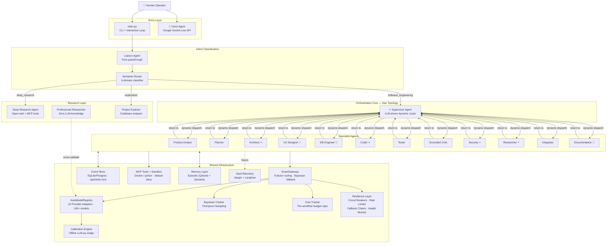
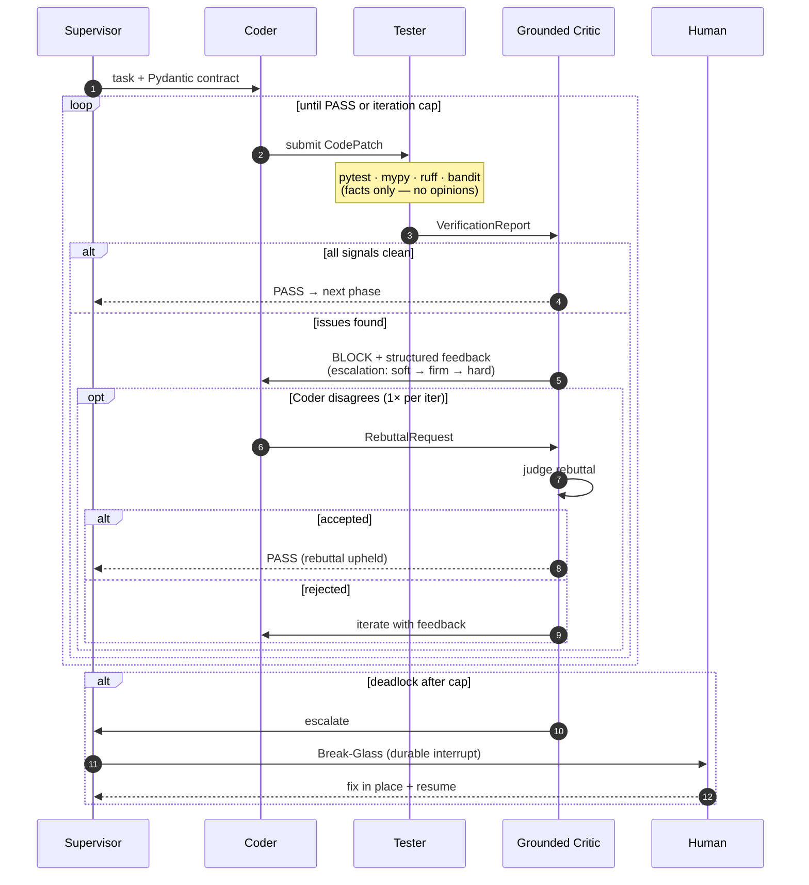

<a id="top"></a>

<div align="center">

# 🤖 Ž Y R E N: Autonomous AI Dev-Team

### The Autonomous Multi-Agent Software Engineering System

**Provider-Agnostic · Grounded Verification · Self-Improving**

[](https://www.repostatus.org/#suspended)
[](https://github.com/MONaser04/ZyrenClaw)
[](#-current-project-status)
[](#-agent-roster--17-specialized-roles)
[](#-provider-adapters--auto-discovery)
[](#-orchestration-engine)
[](#-repository-structure)
[](#-testing--evaluation)
[](#-license)

> A self-hosted, research-grounded **multi-agent SDLC engine** that takes a coding task and returns **runnable, test-passing code** — with full traces, hard cost caps, sandboxed execution, Bayesian model routing, and a human break-glass protocol.

[Overview](#-overview) · [Architecture](#-system-architecture) · [Agents](#-agent-roster--17-specialized-roles) · [Gateway](#-smart-gateway--model-routing) · [Quick Start](#-quick-start) · [Roadmap](#-roadmap)

---

</div>

> [!IMPORTANT]
> **Project Status: Archived & Superseded by ŽyrenClaw (Generation 3)**
> Active development on this repository has concluded and it is preserved in read-only archive mode. This codebase represents the foundational **Generation 1 (17-Agent Swarm)** of the Žyren architecture (built with LangGraph star topology, Bayesian routing, Qdrant memory, and strict Pydantic v2 schemas). All active autonomous multi-agent engineering workflows have evolved into the lightweight, 5-agent vertical hub-and-spoke production architecture at [**MONaser04/ZyrenClaw**](https://github.com/MONaser04/ZyrenClaw).

---

## 📖 Overview

**Ž Y R E N AI Dev-Team** is an autonomous software engineering agency powered by a team of **17 specialized AI agents** coordinated through a **LangGraph star-topology state machine**. A central **Supervisor agent** dynamically routes tasks to the right specialist — planner, architect, coder, tester, critic, security auditor, researcher, and more — creating a complete software development lifecycle in a single command.

### Core Design Principles

| Principle | Implementation |
|---|---|
| **Verification is tools-first** | Real tests, type-checkers, linters, and execution provide the signal — the LLM only *interprets* it. Based on [MIT Press/TACL findings](https://direct.mit.edu/tacl/article/doi/10.1162/tacl_a_00713/125177/) that LLMs cannot reliably self-correct from internal feedback alone. |
| **Provider-agnostic routing** | The `SmartRouter` sees only `ModelSpec` objects with capabilities, pricing, and limits. It knows nothing about OpenAI vs. Anthropic. Provider is strictly metadata. |
| **Verified ground truth** | The Data Layer (Registry, Gateway, Adapters) **never guesses**. Every model spec has a `SourceCitation` with URL, confidence score, and access timestamp. |
| **Zero API calls in tests** | All 29 test suites run fully offline with `MockGateway`, `MockProviderAPIs`, and `MockEventStore`. |
| **Circuit breakers everywhere** | Per-model, per-provider, per-workflow budget caps with automatic fallback chains, health monitoring, and rate limiting. |

---

## 🏛️ System Architecture



### Orchestration: Supervisor Star Topology

Unlike a static pipeline, Ž Y R E N AI Dev-Team uses a **dynamic star topology**: every specialist agent routes back to the Supervisor after completing its work. The Supervisor — powered by an LLM — analyzes the full execution history and decides the **next best agent** to call:

```
assign_task → Supervisor → [planner|architect|coder|tester|critic|...] → Supervisor → ... → complete
```

This allows the system to:
- Skip unnecessary stages for simple tasks
- Loop coder → tester → critic until tests pass
- Dynamically add security reviews or docs only when needed
- Terminate gracefully or escalate on failure

---

## 🔁 The Grounded Feedback Loop

The core validation cycle. The **first critic is a set of tools**, not an LLM.



**Key features:**
- **Escalation ladder**: Soft (iter 1) → Firm (iter 2) → Hard block (iter 3) → Escalate to Supervisor
- **Right of rebuttal**: Coder can dispute a BLOCK once per iteration with evidence
- **Cross-model diversity**: Critic runs on a different model family than the Coder to reduce shared blind spots
- **Dedicated critics**: Only the three highest-risk roles (Coder, Architect, Security) get dedicated critics

---

## 🤖 Agent Roster — 17 Specialized Roles

| # | Agent | Module | Responsibility | Notes |
|:---:|---|---|---|---|
| 1 | **Supervisor** | `supervisor.py` | Dynamic LLM-driven routing hub | ⭐ Central node |
| 2 | **Product Analyst** | `product_analyst.py` | Prompt → PRD, user stories, acceptance criteria | |
| 3 | **Planner** | `planner.py` | PRD → task DAG, dependencies, assignments | |
| 4 | **Architect** | `architect.py` | System design, ADRs, tech choices | ⭐ Dedicated critic |
| 5 | **UX/UI Designer** | `ux.py` | Design system, accessibility | 🔀 Conditional |
| 6 | **DB Engineer** | `db_engineer.py` | Schema design, migrations | 🔀 Conditional |
| 7 | **Coder** | `coder.py` | Core code producer (frontier model) | ⭐ Dedicated critic |
| 8 | **Tester** | `tester.py` | Runs pytest · mypy · ruff → facts only | External signals |
| 9 | **Grounded Critic** | `critic.py` | Interprets VerificationReport + rubric | Cross-model |
| 10 | **Integrator** | `integrator.py` | Fan-in merge + rollback on failure | |
| 11 | **Security** | `security.py` | OWASP-aligned review + SAST | ⭐ Dedicated critic |
| 12 | **Documentation** | `docs.py` | ADRs (post-arch) + final docs (post-integration) | 📍 Milestone-based |
| 13 | **Liaison** | `liaison.py` | Natural language → system action passthrough | 👤 Human interface |
| 14 | **Researcher** | `researcher.py` | On-demand knowledge gaps during SDLC | ⚡ On-demand |
| 15 | **Professional Researcher** | `professional_researcher.py` | Zero-LLM-knowledge, verified sources only | 🔬 11 doc fetchers |
| 16 | **Deep Research** | `deep_research.py` | Open web research, data aggregation | 🌐 MCP tools |
| 17 | **Project Explorer** | `explorer.py` | Codebase analysis via file_list / file_read | 🔍 Read-only |

**Additional operational agents:**
- **Operator** (`operator.py`) — System administration (add/disable/enable models, set defaults)
- **Voice Agent** (`voice_agent.py`) — Real-time voice interaction via Google Gemini Live API with screen sharing
- **Optimizator** (`optimizator.py`) — Closed-loop self-improvement (eval → analysis → prompt tuning → re-eval)

---

## 🔌 Smart Gateway & Model Routing

### Architecture

All LLM calls flow through a single entry point: **`SmartGateway`** (735 lines). No direct `litellm` calls anywhere else.

```
Agent → LLMClient → SmartGateway → SmartRouter → litellm → Provider API
                         │
                         ├── 6-Factor Routing Decision
                         ├── Bayesian Thompson Sampling
                         ├── Circuit Breakers (per-model)
                         ├── Fallback Chains (with cooldown)
                         ├── Rate Limiting (per-provider)
                         ├── Health Monitoring
                         └── Cost Tracking (per-workflow caps)
```

### 6-Factor Routing

The `SmartRouter` considers:

1. **Task Complexity** — simple / medium / complex
2. **Required Capabilities** — vision, function calling, structured output, context length
3. **Cost Budget** — per-workflow USD caps, enforced by `CostTracker`
4. **Performance History** — Bayesian Beta Distribution (Thompson Sampling)
5. **Availability** — circuit breaker state, rate limit headroom
6. **Manual Override** — user preferences via Liaison (e.g., *"Make gpt-4o-mini the default for fast tasks"*)

### Bayesian Model Quality Tracking

The `BayesianTracker` maintains a **Beta(α, β) distribution** per model, updated via **offline calibration** against an 80-question golden dataset across coding, reasoning, and general categories. Models are selected using **Thompson Sampling** for optimal exploration/exploitation balance.

### Provider Adapters & Auto-Discovery

| Provider | Adapter | Doc Fetcher | Auto-Discovery |
|---|---|---|:---:|
| **OpenAI** | `openai.py` | `openai_docs.py` | ✅ |
| **Anthropic** | `anthropic.py` | `anthropic_docs.py` | ✅ |
| **Google (Vertex)** | `google.py` | `google_docs.py` | ✅ |
| **NVIDIA NIM** | `nvidia_nim.py` | `nvidia_docs.py` | ✅ |
| **Azure OpenAI** | `azure.py` | `azure_docs.py` | ✅ |
| **AWS Bedrock** | `aws_bedrock.py` | `aws_docs.py` | ✅ |
| **Ollama** | `ollama.py` | `ollama_docs.py` | ✅ |
| **Together AI** | `together.py` | `together_docs.py` | ✅ |
| **Fireworks AI** | `fireworks.py` | `fireworks_docs.py` | ✅ |
| **Groq** | `groq.py` | `groq_docs.py` | ✅ |

Each adapter implements the `ProviderAdapter` interface and registers with the `AutoModelRegistry`. The `ProfessionalResearcherAgent` uses 11 dedicated **doc fetchers** to cross-validate model specs against official sources.

---

## ⚡ Quick Start

### Prerequisites

- **Python ≥ 3.11**
- **[uv](https://github.com/astral-sh/uv)** (recommended) or pip
- At least one LLM provider API key (NVIDIA NIM, OpenAI, etc.)

### Installation

```bash
# Clone the repository
git clone https://github.com/zyren04/Autonomous-AI-Dev-Team.git
cd Autonomous-AI-Dev-Team

# Install dependencies
uv sync

# Configure environment
cp .env.example .env
# Edit .env with your API keys
```

### Usage

```bash
# Interactive mode (recommended)
python main.py

# One-liner execution
python main.py "Write a FastAPI CRUD app for a todo list"

# Voice mode (requires PyAudio + Google Gemini API key)
python main.py voice

# Calibrate model quality scores
# (type "calibrate" in the interactive prompt)
```

### Infrastructure (Optional)

```bash
# Start local services (Postgres, Qdrant, LiteLLM, Jaeger, Langfuse)
make up

# Run tests (fully offline, zero API calls)
make test

# Full CI check (lint + typecheck + test)
make all
```

---

## 🧪 Testing & Evaluation

### Test Infrastructure (29 Test Suites)

All tests run with **zero real API calls** using comprehensive mocks:

| Category | Files | Coverage |
|---|---|---|
| **Core Loop** | `test_orchestrator.py`, `test_contracts.py`, `test_state.py` | State machine, Pydantic contracts, event store |
| **Agents** | `test_agents.py`, `test_verification.py`, `test_smoke.py` | All 17 agent roles, verification steps |
| **Gateway** | `test_phase3_gateway.py`, `test_phase3_cost_tracker.py` | SmartGateway, routing, cost caps |
| **Routing** | `test_routing.py`, `test_bayesian_routing.py`, `test_beta_routing.py` | Bayesian tracker, Thompson sampling |
| **Tools** | `test_phase3_mcp_registry.py`, `test_phase3_policy_engine.py`, `test_phase3_memory.py` | MCP registry, policies, memory |
| **HITL** | `test_hitl.py`, `test_phase5_closed_loop.py`, `test_phase5_e2e.py` | Break-glass, convergence, artifacts |
| **Evaluation** | `test_phase5_eval.py`, `test_phase6_*` (5 files) | LLM-as-Judge, trajectory eval, red-team |
| **Optimization** | `test_phase7_optim.py` | DSPy/GEPA prompt tuning, convergence |
| **Research** | `test_professional_researcher.py`, `test_registry_crud.py` | Doc fetchers, registry CRUD |
| **Observability** | `test_phase4_observability_setup.py` | OTel spans, metrics |

### Evaluation Harness

| Suite | Location | Purpose |
|---|---|---|
| **Golden Set** | `evals/golden/tasks.yaml` (20+ tasks) | Personal benchmark tasks |
| **SWE-bench** | `evals/swebench/harness.py` | Real GitHub issue resolution |
| **LLM-as-Judge** | `evals/judges/` | Calibrated judge rubrics (Cohen's κ > 0.6) |
| **Red Team** | `evals/redteam/` | PyRIT + garak campaigns against OWASP Top 10 |
| **Router Eval** | `evals/router/` | Routing quality + anti-drift guardrails |

---

## 🧱 Core Subsystems

### Event-Sourced State (`src/state/`)

Every workflow mutation is an **immutable event** in an append-only log. Current state is a projection:

- **Event types**: 15+ types covering task lifecycle, coding cycle, rebuttal flow, full SDLC
- **Schema**: `{event_id, workflow_id, agent_id, event_type, payload, version, timestamp, causation_id, correlation_id}`
- **Optimistic locking**: Version-checked conditional writes prevent concurrent overwrites
- **Storage**: SQLite for local dev, Postgres for production

### Type-Safe Contracts (`src/contracts/`)

Every agent boundary is a **strict Pydantic v2 schema** validated before committing to the event log:

| Contract | Flow | Lines |
|---|---|---|
| `TaskAssignment` | Orchestrator → Coder | Schema: description, language, constraints, iteration |
| `CodePatch` | Coder → Tester | Files with path + content, explanation |
| `VerificationReport` | Tester → Critic | Test results, type-check, lint, security (facts only) |
| `ReviewDecision` | Critic → Orchestrator | Verdict (PASS/BLOCK), issues, escalation level |
| `RebuttalRequest` | Coder → Critic | Justification, disputed issues |
| `ProductRequirementDoc` | Analyst → Planner | User stories, acceptance criteria |
| `ArchitectDesign` | Architect → Fan-out | ADRs, component diagram, tech choices |
| `ResearchReport` | Deep Research → Complete | Key findings, data points, sources, confidence |

### Semantic Router (`src/orchestrator/semantic_router.py`)

6-domain classifier with confidence-aware routing:

| Domain | Description | Route |
|---|---|---|
| `software_engineering` | Coding, debugging, architecture | → Supervisor star topology |
| `deep_research` | Open web research, market analysis | → Deep Research Agent |
| `media_production` | Audio, image, video generation | → Media Production (placeholder) |
| `conversational` | General chat, greetings | → Direct LLM response |
| `system_command` | Model registry management | → Operator Agent |
| `os_command` | File deletion, directory ops | → Operator Agent |

**Complexity sub-routing** for software engineering:
- **SIMPLE** → Fast Lane (direct Coder → Critic)
- **MEDIUM** → Full SDLC pipeline
- **COMPLEX** → Full SDLC with fan-out parallelism
- **EXPLORATION** → Project Explorer (read-only codebase analysis)

### Resilience Layer (`src/resilience/`)

| Component | File | Purpose |
|---|---|---|
| **Circuit Breaker** | `circuit_breaker.py` (301 lines) | Per-model failure tracking, CLOSED → OPEN → HALF_OPEN states |
| **Fallback Chain** | `fallback_chain.py` (190 lines) | Ordered model fallback with cooldown periods |
| **Rate Limiter** | `rate_limiter.py` (210 lines) | Per-provider token bucket rate limiting |
| **Health Monitor** | `health_monitor.py` (300 lines) | Continuous health checks with alerting |

### Memory Layer (`src/memory/`)

| Type | File | Backend |
|---|---|---|
| **Working** | (context window) | In-memory |
| **Episodic** | `episodic.py` (376 lines) | Qdrant vector store — past runs/failures by similarity |
| **Semantic** | `semantic.py` (298 lines) | Key-value store — project conventions, mandates |

### MCP Tools & Sandbox (`src/tools/`)

- **MCP Registry** (`mcp_registry.py`, 544 lines) — Model Context Protocol tool definitions
- **Policy Engine** (`policy_engine.py`, 498 lines) — Default-deny, role-scoped permission matrix
- **Tool Executor** (`tool_executor.py`, 482 lines) — Executes tools with policy enforcement
- **Sandbox** (`sandbox.py`, 336 lines) — Hardened Docker execution (network off, caps dropped, read-only FS)

### Observability (`src/observability/`)

Instrumented with **OpenTelemetry GenAI semantic conventions**:

- Spans: `invoke_agent.{role}` → `chat` → `execute_tool.{name}`
- Attributes: `gen_ai.request.model`, `gen_ai.usage.input_tokens`, `gen_ai.response.finish_reason`
- Metrics: `gen_ai.client.token.usage`, `gen_ai.client.operation.duration`
- Backends: **Jaeger** (traces UI), **Langfuse** (LLM observability, prompts, cost, quality)
- Prompt-content capture **off by default** (privacy)

### Self-Improvement (`optim/`)

Closed-loop optimization pipeline:

| Module | Purpose |
|---|---|
| `analyser.py` | Analyzes evaluation round results, identifies failure patterns |
| `convergence.py` | Checks if optimization has converged (improvement threshold + patience) |
| `feedback_store.py` | SQLite-backed persistent storage for optimization feedback |
| `model_optimiser.py` | Optimizes model routing based on evaluation data |
| `prompt_tuner.py` | Automated prompt optimization (DSPy MIPROv2 / GEPA) |
| `reporter.py` | Generates optimization reports |

---

## 📂 Repository Structure

```text
zyren-ai-dev-team/                          # 19,597 lines · 100 Python files
├── main.py                           # Interactive CLI + one-liner + voice mode
├── pyproject.toml                    # uv/hatch, Python ≥3.11, pinned deps
├── Makefile                          # install · test · lint · format · typecheck · up · down · eval
├── docker-compose.yml                # Postgres · Qdrant · LiteLLM · Jaeger · Langfuse
├── .env.example                      # 10 provider keys + infra config
│
├── config/
│   ├── litellm.yaml                  # 4-alias routing (frontier/fast/critic/fallback)
│   ├── policies.yaml                 # Default-deny tool permission matrix
│   ├── phase5.yaml                   # Optimization loop configuration
│   ├── router_eval.yaml              # Router evaluation config
│   └── agents/                       # Per-agent prompt + contract configs
│
├── src/
│   ├── orchestrator/                 # LangGraph state machine (1,148-line graph.py)
│   │   ├── graph.py                  # Star topology: all agents → Supervisor → next agent
│   │   ├── runner.py                 # Workflow runner with Phase 5 hooks
│   │   ├── semantic_router.py        # 6-domain + complexity sub-classifier
│   │   ├── hitl.py                   # Human-in-the-Loop (CLI/webhook/auto)
│   │   ├── convergence.py            # Early stopping when improvements plateau
│   │   ├── artifacts.py              # Versioned build artifact management
│   │   └── command_executor.py       # System command execution
│   │
│   ├── agents/                       # 17+ role agents (23 Python files)
│   │   ├── supervisor.py             # ⭐ Dynamic LLM-driven routing hub
│   │   ├── coder.py                  # Frontier model code generation + rebuttal
│   │   ├── critic.py                 # Grounded critic with escalation ladder
│   │   ├── tester.py                 # External verification signal generator
│   │   ├── deep_research.py          # Open web research with MCP tools
│   │   ├── explorer.py               # Codebase exploration (file_list/file_read)
│   │   ├── professional_researcher.py # Zero-LLM-knowledge verified researcher
│   │   ├── voice_agent.py            # Real-time voice via Gemini Live API
│   │   ├── operator.py               # System administration agent
│   │   ├── optimizator.py            # Closed-loop self-improvement orchestrator
│   │   ├── liaison.py                # Natural language passthrough
│   │   ├── critic_factory.py         # Dedicated critic creation per role
│   │   └── researcher_docs/          # 11 provider-specific doc fetchers
│   │       ├── openai_docs.py        #   (OpenAI, Anthropic, Google, NVIDIA,
│   │       ├── anthropic_docs.py     #    Azure, AWS, Ollama, Together,
│   │       ├── ...                   #    Fireworks, Groq)
│   │       └── base.py               #   OfficialDocsFetcher base class
│   │
│   ├── gateway/                      # SmartGateway + 10 Provider Adapters
│   │   ├── smart_gateway.py          # THE gateway (735 lines, 6-factor routing)
│   │   ├── model_registry.py         # AutoModelRegistry (814 lines, auto-discovery)
│   │   ├── llm_client.py             # Thin sync/async wrapper → SmartGateway
│   │   ├── cost_tracker.py           # Per-workflow budget enforcement
│   │   ├── bayesian_tracker.py       # Beta distribution + Thompson Sampling
│   │   ├── evaluator.py              # Offline LLM-as-Judge calibration
│   │   ├── golden_dataset.json       # 80-question calibration dataset
│   │   ├── routing/
│   │   │   ├── calibration_engine.py # Background calibration queue
│   │   │   └── route_profile.py      # Routing profile definitions
│   │   └── providers/                # 10 provider adapters
│   │       ├── openai.py · anthropic.py · google.py · nvidia_nim.py
│   │       ├── azure.py · aws_bedrock.py · ollama.py
│   │       └── together.py · fireworks.py · groq.py
│   │
│   ├── contracts/                    # Pydantic v2 strict-mode schemas (8 files)
│   │   ├── schemas.py                # 797 lines — all inter-agent contracts
│   │   ├── system_commands.py        # SystemAction enum + AR/EN parser
│   │   ├── feedback.py · intent.py · run.py
│   │   ├── eval_result.py · optim_report.py
│   │   └── __init__.py
│   │
│   ├── state/                        # Event-sourced append-only log
│   │   ├── events.py                 # 15+ event types, immutable Event model
│   │   ├── store.py                  # Abstract + SQLite implementation
│   │   └── projections.py            # Current state from event replay
│   │
│   ├── resilience/                   # 4-component resilience layer
│   │   ├── circuit_breaker.py        # CLOSED → OPEN → HALF_OPEN
│   │   ├── fallback_chain.py         # Ordered model fallback
│   │   ├── rate_limiter.py           # Token bucket per-provider
│   │   └── health_monitor.py         # Continuous health checks
│   │
│   ├── memory/                       # Episodic + Semantic memory
│   │   ├── episodic.py               # Qdrant vector store integration
│   │   ├── semantic.py               # Key-value project facts
│   │   └── memory_manager.py         # Unified memory interface
│   │
│   ├── tools/                        # MCP tools + sandboxing
│   │   ├── mcp_registry.py           # MCP-compliant tool definitions
│   │   ├── policy_engine.py          # Default-deny role-scoped permissions
│   │   ├── tool_executor.py          # Execute with policy enforcement
│   │   ├── sandbox.py                # Docker/gVisor hardened execution
│   │   ├── screen_capture.py         # Screen sharing for voice agent
│   │   └── liaison_tool.py           # Liaison delegation tool
│   │
│   ├── verification/                 # Composable external signal generators
│   │   ├── steps.py                  # pytest · mypy · ruff · bandit steps
│   │   └── runner.py                 # Chains verification steps in order
│   │
│   └── observability/                # OpenTelemetry GenAI instrumentation
│       ├── instrumentation.py        # @trace_agent_invocation decorator
│       ├── tracing.py                # OTel tracer + span names
│       └── metrics.py                # Token usage + duration metrics
│
├── evals/                            # Evaluation harness (5 suites)
│   ├── golden/                       # 20+ personal golden tasks
│   ├── swebench/                     # SWE-bench Lite/Verified harness
│   ├── judges/                       # LLM-as-Judge calibration + rubrics
│   ├── redteam/                      # PyRIT + garak OWASP campaigns
│   └── router/                       # Router quality evaluation
│
├── optim/                            # Self-improvement optimization
│   ├── analyser.py · convergence.py · feedback_store.py
│   ├── model_optimiser.py · prompt_tuner.py · reporter.py
│   └── feedback.db                   # SQLite optimization history
│
├── tests/                            # 29 test files (zero API calls)
│   ├── mocks/                        # MockGateway, MockProviderAPIs, etc.
│   └── fixtures/                     # sample_models.json, golden_tasks.yaml
│
├── scripts/                          # Maintenance + debugging scripts
│   ├── run_supervisor.py             # Run supervisor optimization
│   ├── test_run_phase5.py            # Phase 5 integration test script
│   └── audit_ground_truth.py         # Audit model registry ground truth
│
└── docs/
    └── COMPREHENSIVE_MASTER_PLAN.md  # 92KB detailed implementation plan
```

---

## 🗺️ Roadmap

| Phase | Focus | Key Deliverables | Status |
|:---:|---|---|:---:|
| **0** | Foundation & Environment | Repo setup, circular import fixes, mock test infra | ✅ Done |
| **1** | State, Contracts & Minimal Loop | Event store, Pydantic schemas, Coder→Tester→Critic loop, AutoModelRegistry | ✅ Done |
| **2** | Grounded Verification Layer | Tester agent, Grounded Critic, rebuttal protocol, ProfessionalResearcher | ✅ Done |
| **3** | Gateway, Tools & Memory | SmartGateway, 10 provider adapters, MCP tools, sandbox, memory | ✅ Done |
| **4** | Observability & Full Roster | OTel instrumentation, Supervisor star topology, full SDLC fan-out/fan-in | ✅ Done |
| **5** | Resilience & HITL | Circuit breakers, fallback chains, break-glass protocol, convergence | ✅ Done |
| **6** | Evaluation & Red-Teaming | Golden set, SWE-bench, LLM-as-Judge, PyRIT/garak red-team | ✅ Done |
| **7** | Self-Improvement & Hardening | DSPy/GEPA prompt optimization, Bayesian routing, governance | 🟨 In Progress |

---

## 📊 Current Project Status

| Metric | Value |
|---|---|
| **Source files** | 100 Python files across 10 packages |
| **Lines of code** | 19,597 lines (src/ only) |
| **Test suites** | 29 test files, fully offline |
| **Agent roles** | 17 specialized + 3 operational |
| **Provider adapters** | 10 (with 11 doc fetchers) |
| **Contract schemas** | 797 lines of strict Pydantic v2 |
| **Event types** | 15+ in the event-sourced log |
| **Golden tasks** | 20+ evaluation tasks |
| **Calibration questions** | 80 (coding + reasoning + general) |

---

## ✅ Definition of Done (v1)

The system autonomously takes a well-specified coding task and produces **runnable, test-passing code**, with:

- [x] Full OpenTelemetry traces of every agent/tool call
- [x] Hard per-workflow cost caps enforced (CostTracker + LiteLLM)
- [x] All code executed in a secure sandbox (Docker/gVisor)
- [x] Working human break-glass interrupt + resume (HITL gates)
- [ ] Measured **SWE-bench Lite** score that beats a single-agent baseline

---

## 📚 Research Basis & Sources

| Topic | Source |
|---|---|
| **Agentic Patterns** | [Anthropic — "Building Effective Agents"](https://www.anthropic.com/engineering/building-effective-agents) |
| **Self-Correction** | [MIT Press/TACL — "When Can LLMs Actually Correct Their Own Mistakes?"](https://direct.mit.edu/tacl/article/doi/10.1162/tacl_a_00713/125177/) |
| **Security** | [OWASP Top 10 for Agentic Applications 2026](https://genai.owasp.org/resource/owasp-top-10-for-agentic-applications-for-2026/) |
| **Tools Protocol** | [Model Context Protocol (MCP)](https://spec.modelcontextprotocol.io/) — Linux Foundation |
| **Agent Interop** | [A2A Protocol v1.0](https://a2a-protocol.org/latest/) — Linux Foundation |
| **Observability** | [OpenTelemetry GenAI Semantic Conventions](https://opentelemetry.io/blog/2026/genai-observability/) |
| **Optimization** | [DSPy MIPROv2](https://dspy.ai/) · [GEPA](https://github.com/gepa-ai/gepa) |
| **Evaluation** | [promptfoo](https://www.promptfoo.dev/) · [DeepEval](https://deepeval.com/) |
| **Benchmarks** | [SWE-bench](https://www.swebench.com/) · Reflexion (NeurIPS 2023) · Self-Refine (NeurIPS 2023) |
| **Frameworks** | [LangGraph](https://github.com/langchain-ai/langgraph) · [LiteLLM Router](https://docs.litellm.ai/docs/routing) |

---

## 📄 License

[MIT](LICENSE) — simple and permissive for an open-source build.

---

<div align="center">

*Research-grounded · Verification-first · Provider-agnostic*

*Built on verifiable external signals, not LLM sycophancy.*

</div>
