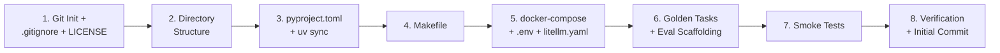

# 🛠️ Phase 0 — Foundation & Local Dev Environment — Implementation Plan

> **Goal:** Bootstrap the entire `zyren-ai-dev-team` project from zero to a reproducible, runnable local development environment — covering the three Phase 0 deliverables from the README.

---

## System Audit (Verified ✅)

| Tool | Status | Version |
|---|---|---|
| Python | ✅ Installed | 3.14.5 |
| `uv` | ✅ Installed | 0.11.24 |
| Docker | ✅ Installed | 29.6.1 |
| Docker Compose | ✅ Installed | v5.2.0 |
| Git | ✅ Installed | 2.54.0 |
| Poetry | ❌ Not needed | — (`uv` is the chosen manager) |

> [!IMPORTANT]
> All required prerequisites are available. No additional installations needed to begin.

---

## Proposed Changes

The plan follows the three Phase 0 deliverables **exactly as specified in the README** (lines 204–207).

---

### Component 1 — Git Repository & Project Skeleton

> **Deliverable:** *"Single Python monorepo (`uv`/`poetry`), pinned dependencies, `Makefile` targets"*

#### [NEW] `.gitignore`
Python-specific `.gitignore` (venv, `__pycache__`, `.env`, IDE files, Docker volumes, etc.)

#### [NEW] `LICENSE`
MIT License file (as recommended in the README line 487).

#### [NEW] Git initialization
- `git init` + initial commit with README + LICENSE + `.gitignore`

---

### Component 2 — Python Monorepo with `uv`

> **Deliverable:** *"Single Python monorepo (`uv`), pinned dependencies"*

#### [NEW] `pyproject.toml`
- Project metadata: `zyren-ai-dev-team`, version `0.1.0`, Python `>=3.12`
- **Core dependencies** (Phase 0 — minimal set):
  - `langgraph` — the chosen orchestration engine
  - `langchain-core` — base abstractions
  - `litellm` — model gateway
  - `pydantic>=2.0` — type-safe contracts
  - `python-dotenv` — environment config
- **Dev dependencies**:
  - `pytest`, `pytest-asyncio`, `pytest-cov` — testing
  - `ruff` — linting + formatting
  - `mypy` — type checking
  - `pre-commit` — git hooks

#### [NEW] `uv.lock`
Auto-generated by `uv sync` with pinned, reproducible dependencies.

#### [NEW] Directory structure
Full proposed repository structure from the README (lines 369–398):

```text
zyren-ai-dev-team/  (d:\Downloads\AI_DEV_TEAM\)
├── README.md                 (exists)
├── pyproject.toml            [NEW]
├── Makefile                  [NEW]
├── docker-compose.yml        [NEW]
├── .env.example              [NEW]
├── .gitignore                [NEW]
├── LICENSE                   [NEW]
├── config/
│   ├── litellm.yaml          [NEW]
│   ├── agents/               [NEW — empty, with .gitkeep]
│   └── policies.yaml         [NEW — skeleton]
├── src/
│   ├── __init__.py
│   ├── orchestrator/         [NEW — __init__.py only]
│   ├── agents/               [NEW — __init__.py only]
│   ├── contracts/            [NEW — __init__.py only]
│   ├── state/                [NEW — __init__.py only]
│   ├── memory/               [NEW — __init__.py only]
│   ├── tools/                [NEW — __init__.py only]
│   ├── verification/         [NEW — __init__.py only]
│   ├── resilience/           [NEW — __init__.py only]
│   ├── observability/        [NEW — __init__.py only]
│   └── gateway/              [NEW — __init__.py only]
├── evals/
│   ├── golden/               [NEW — README + placeholder]
│   ├── swebench/             [NEW — README + placeholder]
│   ├── judges/               [NEW — empty, with .gitkeep]
│   └── redteam/              [NEW — empty, with .gitkeep]
├── optim/                    [NEW — empty, with .gitkeep]
└── tests/
    ├── __init__.py
    └── test_smoke.py         [NEW — initial smoke test]
```

---

### Component 3 — Makefile Targets

> **Deliverable:** *"`Makefile` targets"*

#### [NEW] `Makefile`
Practical targets for daily development:

| Target | Command | Purpose |
|---|---|---|
| `make install` | `uv sync` | Install all dependencies |
| `make test` | `pytest tests/` | Run test suite |
| `make lint` | `ruff check src/ tests/` | Lint code |
| `make format` | `ruff format src/ tests/` | Auto-format code |
| `make typecheck` | `mypy src/` | Static type checking |
| `make up` | `docker compose up -d` | Start local infra |
| `make down` | `docker compose down` | Stop local infra |
| `make eval` | (placeholder) | Run eval harness |
| `make clean` | Remove caches | Cleanup |
| `make all` | lint + typecheck + test | Full CI check |

---

### Component 4 — Docker Compose for Local Infrastructure

> **Deliverable:** *"`docker-compose.yml` for local infra (Postgres + vector store + LiteLLM + an OTLP backend)"*

#### [NEW] `docker-compose.yml`
Four services as specified in the README:

| Service | Image | Port | Purpose |
|---|---|---|---|
| `postgres` | `postgres:16-alpine` | 5432 | Event-sourced state store |
| `qdrant` | `qdrant/qdrant:latest` | 6333/6334 | Vector store (for episodic memory) |
| `litellm` | `ghcr.io/berriai/litellm:main-latest` | 4000 | Model gateway proxy |
| `jaeger` | `jaegertracing/jaeger:latest` | 16686/4317/4318 | OTLP backend (traces) |

#### [NEW] `.env.example`
Template with all required environment variables (API keys, DB credentials, ports).

#### [NEW] `config/litellm.yaml`
Initial LiteLLM configuration with model registry, routing rules, and cost cap placeholders.

---

### Component 5 — Golden Task Set (Day-One Eval Harness)

> **Deliverable:** *"Wire up SWE-bench Lite as the smoke test and pick 10–20 personal golden tasks before writing any agent."*

#### [NEW] `evals/golden/README.md`
Documentation explaining the golden task format and how to add tasks.

#### [NEW] `evals/golden/tasks.yaml`
Skeleton YAML with 5 starter golden task templates (to be filled by the user with real tasks):
- Each task has: `id`, `description`, `input`, `expected_output`, `tags`, `difficulty`

#### [NEW] `evals/swebench/README.md`
Instructions for wiring up SWE-bench Lite integration.

#### [NEW] `evals/swebench/run_harness.py`
Placeholder script that will run the SWE-bench Lite evaluation harness.

---

### Component 6 — Initial Smoke Test & Validation

#### [NEW] `tests/test_smoke.py`
Validates that the foundation is correctly set up:
- Python version check
- All core imports work (`langgraph`, `litellm`, `pydantic`)
- Project structure exists
- Contracts package is importable

---

## Open Questions

> [!IMPORTANT]
> **LiteLLM Model Configuration:** Which LLM providers/API keys do you plan to use initially? (e.g., OpenAI, Anthropic, Google, local Ollama models). This affects the `config/litellm.yaml` routing setup. I'll create a generic template with placeholders for now.

> [!IMPORTANT]
> **Vector Store Choice:** The README mentions "vector store" generically. I'll use **Qdrant** (open-source, easy Docker setup). Alternatives: Chroma, Weaviate, Milvus. Confirm or I proceed with Qdrant.

---

## Verification Plan

### Automated Tests
```bash
make install          # uv sync — all deps resolve
make lint             # ruff passes clean
make typecheck        # mypy passes clean
make test             # pytest — smoke tests pass
make up               # docker compose — all 4 services start healthy
make down             # clean shutdown
```

### Manual Verification
- Verify directory structure matches the README's proposed layout
- Verify `.env.example` documents all required variables
- Verify `git log` shows a clean initial commit
- Verify Docker services respond on their expected ports

---

## Execution Order



> [!TIP]
> Estimated execution time: **~15 minutes** for all file creation and validation.
