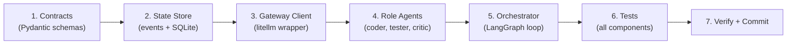

# 🧱 Phase 1 — Core State, Contracts & the Minimal Feedback Loop

> **Goal:** Build the smallest end-to-end loop that takes a coding task and produces working code through the **evaluator-optimizer** pattern — with event-sourced state, type-safe contracts, and a grounded verification cycle.

---

## Analysis Summary

### Current State (Phase 0 ✅)
- **Skeleton project:** All `src/` packages exist but contain only `__init__.py` placeholders
- **Dependencies:** `langgraph`, `langchain-core`, `litellm`, `pydantic`, `psycopg`, `httpx` all installed (89 packages)
- **Infrastructure:** Docker Compose ready (Postgres, Qdrant, LiteLLM proxy, Jaeger)
- **Eval harness:** Golden tasks (5 templates) + SWE-bench Lite placeholder ready

### Phase 1 Deliverables (from README lines 216–219)
1. **Event-Sourced State Store** — append-only log, immutable events, state projections
2. **Minimal Event Schema** — `{event_id, workflow_id, agent_id, event_type, payload, version, timestamp, causation_id, correlation_id}` + optimistic locking
3. **Type-Safe Inter-Agent Contracts** — Pydantic schemas (`TaskAssignment`, `CodePatch`, `VerificationReport`, `ReviewDecision`)
4. **Minimal Viable Loop** — Orchestrator → Coder → Tester → Grounded Critic (the evaluator-optimizer pattern)

### Key Design Decisions
- **SQLite for v0** (as stated in README line 216) — zero Docker dependency to run the core loop; Postgres migration in later phases
- **Direct `litellm` calls** — no need for the LiteLLM proxy server during development; the Python SDK routes directly to providers
- **LangGraph StateGraph** — the orchestrator is a LangGraph compiled graph with typed state, conditional edges, and iteration caps

---

## Proposed Changes

### Component 1 — Event-Sourced State Store (`src/state/`)

> README: *"Workflow state as an append-only event log... Each mutation is immutable; current state is a projection."*

#### [NEW] `src/state/events.py`
The core event model and event types:
- `Event` — Pydantic model with all 9 fields from the README schema
- `EventType` — enum (`TASK_CREATED`, `CODE_SUBMITTED`, `VERIFICATION_COMPLETED`, `REVIEW_DECIDED`, `WORKFLOW_COMPLETED`, `WORKFLOW_FAILED`)
- Event factory functions for each type

#### [NEW] `src/state/store.py`
The event store implementation:
- `EventStore` — abstract base class defining the interface
- `SQLiteEventStore` — SQLite-backed implementation with:
  - `append(event)` — immutable insert with optimistic locking (version check)
  - `get_events(workflow_id)` — replay all events for a workflow
  - `get_latest_version(workflow_id)` — for optimistic locking
  - `get_current_state(workflow_id)` — project events into current `WorkflowState`
  - Automatic schema creation on init
- `OptimisticLockError` — raised on version conflict

#### [NEW] `src/state/projections.py`
State projections — fold events into current workflow state:
- `project_workflow_state(events)` — reduces a list of events to a `WorkflowState`

---

### Component 2 — Type-Safe Contracts (`src/contracts/`)

> README: *"Every boundary is a strict schema (PRD, ArchitectDesign, CodePatch, ReviewReport). Validate before committing to the log."*

#### [NEW] `src/contracts/schemas.py`
Pydantic v2 strict-mode schemas for the minimal loop:

| Schema | Used At | Description |
|---|---|---|
| `TaskAssignment` | Orchestrator → Coder | Task description, language, constraints, iteration number |
| `CodePatch` | Coder → Tester | The generated code/patch with file mapping |
| `VerificationReport` | Tester → Critic | Test results, type errors, lint violations — **facts only** |
| `ReviewDecision` | Critic → Orchestrator/Coder | `PASS` or `BLOCK` + structured feedback |
| `WorkflowState` | State projection | Current status, iteration count, history of patches/reviews |

Each schema:
- Uses `model_config = ConfigDict(strict=True)` for strict validation
- Has `model_validator` for cross-field validation
- Carries a `created_at` timestamp

---

### Component 3 — Gateway Client (`src/gateway/`)

> Thin wrapper around `litellm` for direct API calls with consistent error handling.

#### [NEW] `src/gateway/llm_client.py`
- `LLMClient` class with:
  - `complete(model, messages, response_model)` — call LLM with structured output (Pydantic)
  - `complete_text(model, messages)` — plain text completion
  - Built-in retry with exponential backoff (3 retries)
  - Consistent error handling and logging
  - Model name mapping from config aliases (`frontier`, `fast`, `critic`)

---

### Component 4 — Role Agents (`src/agents/`)

> README: *"Ship the smallest end-to-end loop... Coder generates a patch → Tester runs tests/types/lint → Grounded Critic reads those real signals."*

#### [NEW] `src/agents/base.py`
- `BaseAgent` — abstract base with `agent_id`, `role`, `run(input) -> output` interface

#### [NEW] `src/agents/coder.py`
- `CoderAgent` — takes a `TaskAssignment`, calls the **frontier** model, produces a `CodePatch`
- On feedback iteration: receives prior `ReviewDecision` with structured feedback, incorporates it
- Uses structured output (Pydantic) to guarantee contract compliance

#### [NEW] `src/agents/tester.py`
- `TesterAgent` — takes a `CodePatch`, runs verification tools, produces a `VerificationReport`
- For v0: writes code to a temp directory, runs `ruff check`, `mypy`, and `pytest` in subprocess
- Captures stdout/stderr/exit codes — **facts only, no opinions**
- All execution in a temporary directory (not sandboxed Docker yet — that's Phase 3)

#### [NEW] `src/agents/critic.py`
- `CriticAgent` — takes a `VerificationReport` + `CodePatch` + rubric, produces a `ReviewDecision`
- Uses the **critic** model (different model family than Coder, per README line 231)
- Decision: `PASS` if all checks clean + rubric satisfied; `BLOCK` with structured feedback otherwise
- Feedback includes: specific issues, suggested fixes, severity level

---

### Component 5 — Orchestrator / LangGraph Loop (`src/orchestrator/`)

> README: *"The evaluator-optimizer pattern... loop with a hard cap."*

#### [NEW] `src/orchestrator/graph.py`
The LangGraph `StateGraph` implementing the minimal feedback loop:

```
START → assign_task → coder → tester → critic → [decision]
                                                     ├─ PASS → complete
                                                     └─ BLOCK → coder (loop)
                                                          └─ iteration_cap → fail
```

- Typed state: `GraphState(TypedDict)` with all loop data
- Hard iteration cap (configurable, default 3)
- Events emitted to the `EventStore` at every transition
- Conditional edges based on `ReviewDecision.verdict`

#### [NEW] `src/orchestrator/runner.py`
- `run_workflow(task_description, ...)` — entry point that:
  1. Creates a workflow in the event store
  2. Compiles and runs the LangGraph graph
  3. Returns the final result or failure reason

---

### Component 6 — Agent Prompt Templates (`config/agents/`)

#### [NEW] `config/agents/coder.yaml`
System prompt + instructions for the Coder agent.

#### [NEW] `config/agents/critic.yaml`
System prompt + rubric for the Grounded Critic agent.

---

### Component 7 — Tests (`tests/`)

#### [NEW] `tests/test_contracts.py`
- All schemas validate correctly with valid data
- All schemas reject invalid data (missing fields, wrong types)
- Cross-field validators work

#### [NEW] `tests/test_state.py`
- Events can be appended and retrieved
- Optimistic locking rejects stale writes
- State projection correctly folds events
- Events are immutable (no updates/deletes)

#### [NEW] `tests/test_agents.py`
- Each agent produces the correct output contract type
- Tester correctly captures subprocess results (using a known-good and known-bad code sample)

#### [NEW] `tests/test_orchestrator.py`
- The LangGraph compiles successfully
- The full loop runs end-to-end with mocked LLM calls
- Iteration cap is respected
- Events are emitted at every transition

---

## Open Questions

> [!IMPORTANT]
> **LLM API Key:** To run the full loop (not just mocked tests), you'll need at least one LLM API key set in `.env`. The mocked tests will work without any API key. Do you have an API key ready, or should I focus purely on the mocked test path first?

> [!NOTE]
> **Tester Sandbox:** For v0 the Tester will execute code in a temp directory with subprocess (not Docker-sandboxed). This is acceptable per the README which says *"Start with hardened Docker..."* in Phase 3. Is this acceptable for now?

---

## Verification Plan

### Automated Tests
```bash
uv run pytest tests/test_contracts.py -v     # Contract validation
uv run pytest tests/test_state.py -v         # Event store + projections
uv run pytest tests/test_agents.py -v        # Agent output contracts
uv run pytest tests/test_orchestrator.py -v  # Full loop (mocked)
uv run ruff check src/ tests/               # Lint
uv run mypy src/ --ignore-missing-imports    # Type check
```

### Manual Verification
- Run the full loop with a real LLM API key on a simple golden task
- Verify events are persisted in SQLite and replayable
- Verify iteration cap stops infinite loops

---

## Execution Order



> [!TIP]
> The dependency chain is strictly bottom-up: Contracts → State → Gateway → Agents → Orchestrator. Each layer depends only on layers below it.
